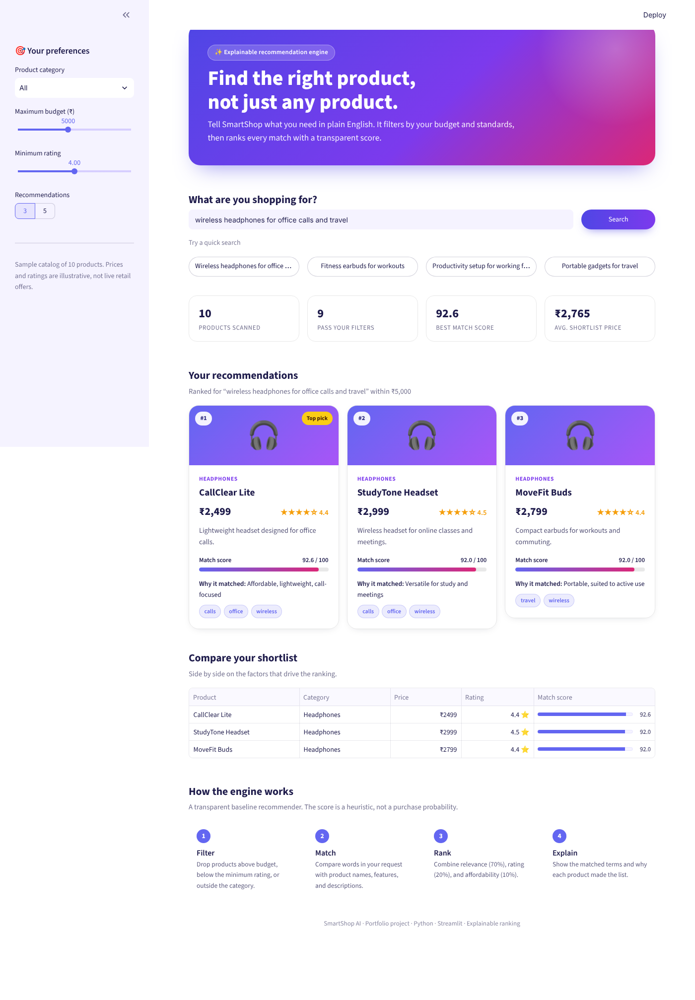

# SmartShop AI — Product Recommendation Agent

[](https://smartshop-appuct-recommendation-ai-agent-cerab3ch3awgrkt9eze8r.streamlit.app/)

**Live demo:** https://smartshop-appuct-recommendation-ai-agent-cerab3ch3awgrkt9eze8r.streamlit.app/



An interactive product recommendation application built with
Python and Streamlit.

## Features
- Natural-language shopping preferences
- Budget, category, and rating filters
- Explainable product ranking
- Recommendation comparison table
- Transparent heuristic scoring
- Polished UI: gradient hero, quick-search chips, live stats,
  ranked product cards, and a custom Streamlit theme

## How it works
Products are filtered by user constraints and ranked using
feature overlap, product rating, and affordability.

## Tech stack
- Python
- Streamlit
- Rule-based recommendation and ranking

## Run locally
```bash
pip install -r requirements.txt
streamlit run app.py
```

## Data
The included product catalog uses illustrative sample data.
Prices and ratings are not live retail offers.
